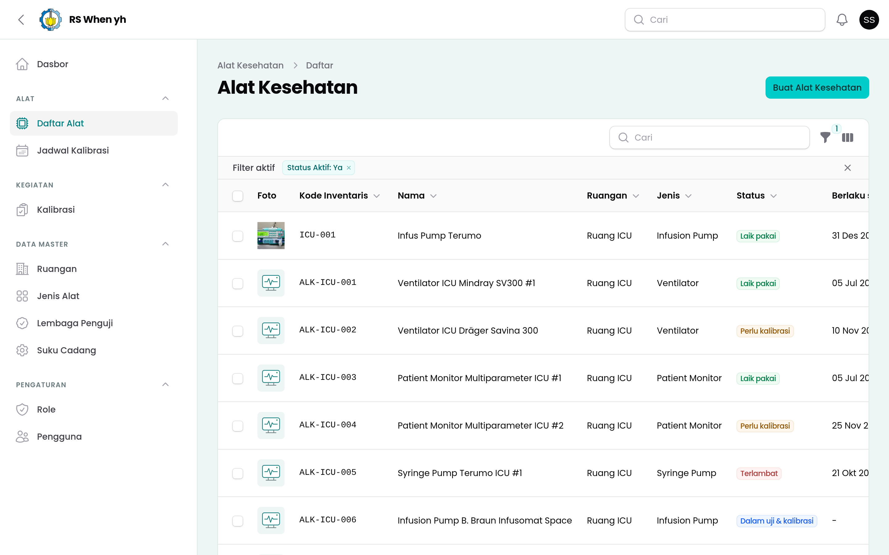
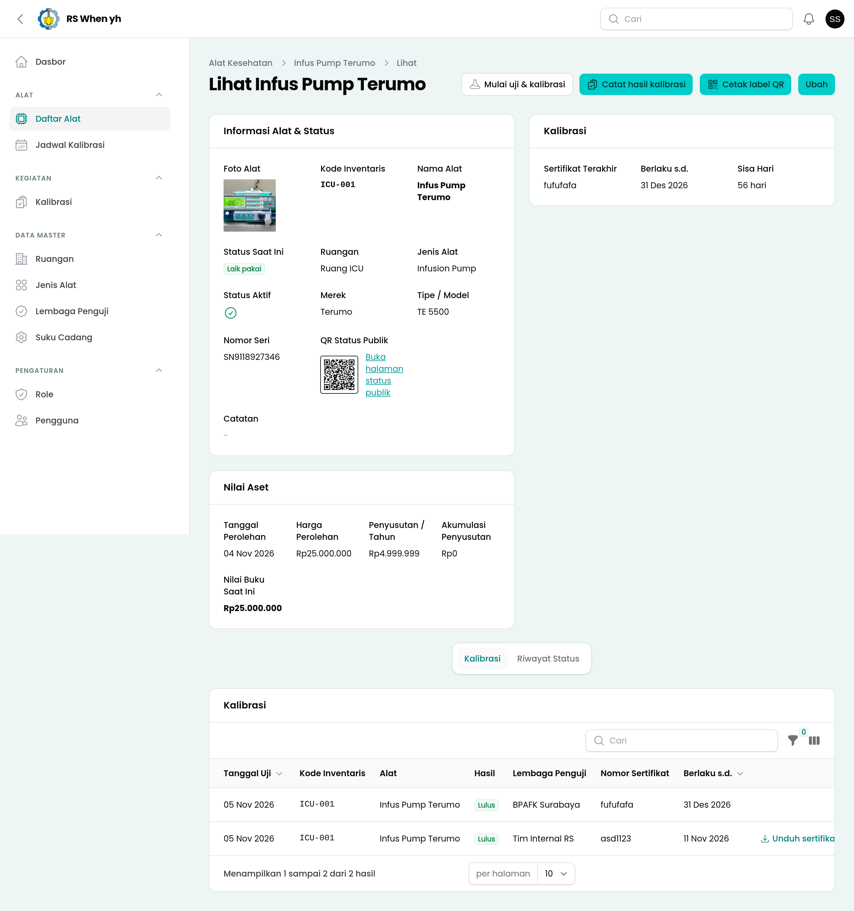
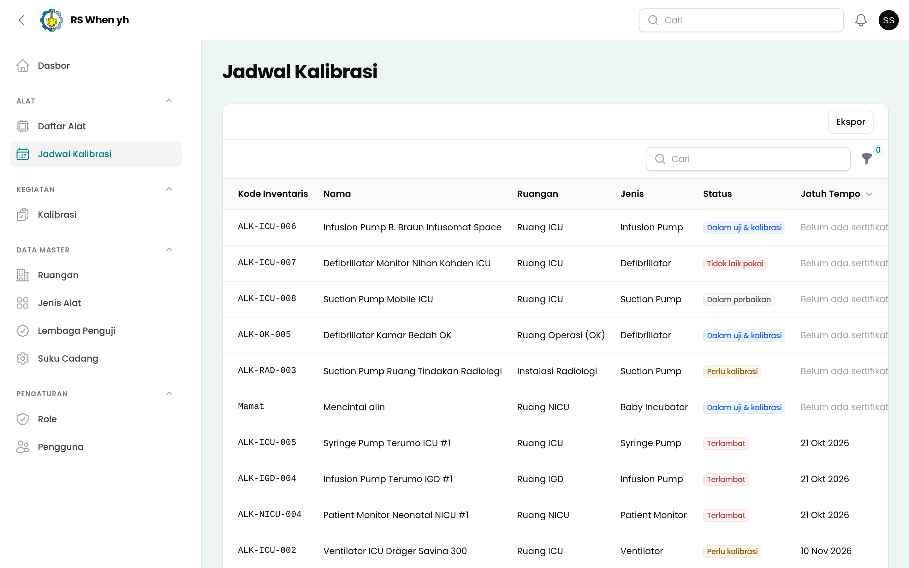
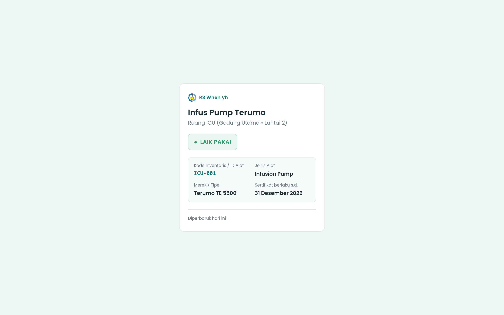

<p align="center">
  
</p>

<h1 align="center">SIGAP-Alkes</h1>

<p align="center">
  <strong>Sistem Informasi Operasional Inventaris, Kalibrasi, Pemeliharaan, dan Nilai Aset Alat Kesehatan Rumah Sakit</strong><br/>
  Departemen Teknologi Kedokteran — Fakultas Kedokteran dan Kesehatan (FKK)<br/>
  Institut Teknologi Sepuluh Nopember (ITS) Surabaya
</p>

<p align="center">
  
  
  
  
  
</p>

---

## Ringkasan Proyek

**SIGAP-Alkes** adalah aplikasi web internal rumah sakit yang dirancang sebagai pendamping operasional harian bagi unit **IPSRS (Instalasi Pemeliharaan Sarana Rumah Sakit)** dan **Elektromedis**. Sistem ini memusatkan pencatatan inventaris alat kesehatan, pemantauan jadwal dan sertifikat kalibrasi, riwayat kerusakan dan perbaikan, mutasi antar-ruangan, hingga perhitungan nilai buku aset.

Aplikasi ini dirancang untuk **melengkapi ASPAK Kemenkes** pada aspek operasional harian di rumah sakit, serta menjaga batas privasi secara ketat dengan **tidak menyimpan data pasien (non-RME)**.

### Tujuan Utama
1. **Kepatuhan Jadwal Kalibrasi**: Mencegah keterlambatan kalibrasi melalui evaluasi status harian dan pengingat otomatis pada H-30, H-7, dan H-0 sebelum masa berlaku sertifikat berakhir.
2. **Transparansi Status Kelaikan via QR Code**: Memudahkan tenaga kesehatan di ruangan untuk memeriksa status kelaikan alat cukup dengan memindai label QR pada unit alat tanpa perlu login.
3. **Rekam Jejak Audit Terpusat**: Mencatat riwayat perpindahan status, sertifikat kalibrasi, perbaikan, dan mutasi ruangan secara terstruktur dan tidak dapat dihapus sembarangan (*no hard-delete*).
4. **Valuasi Aset Manajerial**: Menghitung penyusutan garis lurus (*straight-line depreciation*) dan nilai buku saat ini secara presisi untuk mendukung perencanaan penggantian unit.

---

## Tampilan Antarmuka (Preview Sementara)

| Daftar Inventaris Alat Kesehatan | Detail Alat, QR & Nilai Aset |
| :---: | :---: |
|  |  |

| Jadwal Kalibrasi | Halaman Pemeriksaan Status QR Publik |
| :---: | :---: |
|  |  |

---

## Teknologi yang Digunakan

| Komponen | Spesifikasi | Keterangan |
| :--- | :--- | :--- |
| **Backend Framework** | Laravel 13.x (PHP ≥ 8.3) | Konfigurasi lokal Indonesia (`id`) dan zona waktu `Asia/Jakarta` |
| **Panel Operasional** | Filament 5.x + Livewire 4.x | Antarmuka admin di `/admin` dengan tema kustom Tailwind CSS 4.x |
| **Otorisasi & Peran** | `bezhansalleh/filament-shield` 4.x | Kontrol akses berbasis peran (*Role-Based Access Control*) di atas `spatie/laravel-permission` |
| **Log Aktivitas** | `spatie/laravel-activitylog` 5.x | Pencatatan jejak perubahan data master dan operasional |
| **Generator QR Code** | `chillerlan/php-qrcode` | Pembuatan kode QR berformat SVG untuk halaman publik dan label cetak |
| **Generator PDF** | `barryvdh/laravel-dompdf` | Pencetakan label QR ukuran 60 × 40 mm (satuan maupun massal di kertas A4) |
| **Basis Data** | MySQL 8 / MariaDB | Penyimpanan relasional dengan tipe `decimal(15,2)` dan kalkulasi `bcmath` untuk nilai moneter |
| **Pengujian & Standar Kode** | Pest 4.x & Laravel Pint | Pengujian fitur/unit otomatis dan pemformatan kode standar PSR-12/Laravel |

---

## Pembagian Peran & Hak Akses

Setiap peran dibatasi menggunakan **Filament Shield** dan **Laravel Policy**:

| Peran (`slug`) | Pengguna | Cakupan Hak Akses |
| :--- | :--- | :--- |
| `super_admin` | Pengelola Sistem | Akses penuh ke seluruh modul, manajemen pengguna, dan pengaturan izin peran. |
| `admin_ipsrs` | Admin IPSRS | Mengelola seluruh data master, inventaris alat, akun pengguna staf, serta mencetak label QR PDF. |
| `teknisi` | Teknisi Elektromedis | Melihat seluruh alat, memulai pengujian, serta mencatat hasil kalibrasi, perbaikan, dan mutasi. |
| `kepala_ruangan` | Kepala Ruangan | Hanya dapat melihat daftar dan detail alat yang berada di ruangannya sendiri (`room_id`). |
| `manajemen` | Manajemen RS | Mengakses *dashboard*, jadwal kalibrasi, serta laporan eksekutif dan nilai aset. |
| *Publik (Tanpa Login)* | Pemindai QR | Mengakses halaman `/alat/{qr_token}` yang menampilkan kode inventaris, nama alat, ruangan, status kelaikan, dan masa berlaku sertifikat tanpa mengekspos nilai finansial atau catatan internal. |

---

## Fitur Utama & Aturan Bisnis

### 1. Inventaris Alat & Label QR (`F1`)
- Mencatat kode inventaris unik, nama alat, jenis alat, ruangan, merek/tipe, nomor seri, tanggal dan harga perolehan, nilai residu opsional, foto unit, serta catatan teknis.
- Setiap unit otomatis memperoleh `qr_token` berbentuk **UUID** yang mengarah ke halaman pemeriksaan status publik `/alat/{qr_token}`.
- **Kebijakan Tanpa Hapus Permanen**: Rekaman alat kesehatan tidak dapat dihapus permanen (*hard-delete*); unit yang sudah dipensiunkan dinonaktifkan melalui penanda `is_active = false`.
- **Cetak Label QR PDF**: Tersedia aksi cetak label satuan maupun massal berukuran 60 × 40 mm hitam-putih yang memuat QR code, kode inventaris, nama alat, tipe, dan lokasi ruangan.

### 2. Siklus Status Kelaikan Alat (`F4`)
Perubahan status alat dikelola terpusat melalui `EquipmentStatusService` dan selalu dicatat ke tabel `status_histories`:
- **`fit_for_use` (Laik pakai)** — Sertifikat kalibrasi masih berlaku lebih dari 30 hari (atau alat tidak wajib kalibrasi) dan tidak sedang bermasalah.
- **`calibration_due` (Perlu kalibrasi)** — Alat baru wajib kalibrasi yang belum memiliki sertifikat, masa berlaku sertifikat tersisa ≤ 30 hari, baru selesai diperbaiki, atau baru dimutasi (untuk jenis alat wajib instalasi).
- **`overdue` (Terlambat)** — Masa berlaku sertifikat kalibrasi telah melewati tanggal hari ini.
- **`under_testing` (Dalam uji & kalibrasi)** — Alat sedang dalam proses pengujian/kalibrasi.
- **`under_repair` (Dalam perbaikan)** — Alat sedang dalam penanganan perbaikan oleh teknisi.
- **`unfit` (Tidak laik pakai)** — Alat dinyatakan tidak lulus uji/kalibrasi.

Apabila alat berstatus **Terlambat** atau **Tidak laik pakai**, halaman publik hasil pindai QR akan menampilkan peringatan keselamatan agar unit tidak digunakan pada pasien dan segera menghubungi IPSRS.

### 3. Nilai Aset & Penyusutan Garis Lurus (`F6`)
Perhitungan nilai buku menggunakan metode garis lurus (*straight-line depreciation*) berbasis `bcmath`:
- **Penyusutan Tahunan**: $P = \frac{HP - NR}{MM}$
- **Nilai Buku Saat Ini**: $NB = \max\left(NR,\; HP - \left(P \times \frac{\text{bulan penuh sejak perolehan}}{12}\right)\right)$

---

## Panduan Instalasi Lokal

Pastikan lingkungan pengembangan telah memiliki **PHP ≥ 8.3** (dengan ekstensi `bcmath`, `gd`, `intl`, `mbstring`, `pdo_mysql`), **Composer**, **Node.js & NPM**, serta **MySQL / MariaDB**.

```bash
# 1. Clone repositori
git clone https://github.com/tariqishuman/sigap-alkes.git
cd sigap-alkes

# 2. Instal dependensi PHP dan JavaScript
composer install
npm install

# 3. Salin file konfigurasi environment dan buat application key
cp .env.example .env
php artisan key:generate

# 4. Atur koneksi database (DB_DATABASE, DB_USERNAME, DB_PASSWORD) di file .env
#    kemudian jalankan migrasi beserta seeder akun demo
php artisan migrate --seed

# 5. (Opsional) Isi database dengan data dummy inventaris & riwayat kalibrasi
php artisan sigap:seed-dummy

# 6. Buat symlink storage publik dan build aset frontend
php artisan storage:link
npm run build

# 7. Jalankan server lokal
php artisan serve
```

Akses panel operasional melalui peramban di **`http://localhost:8000/admin`**.

### Perintah Bantuan Data Dummy
```bash
# Mengisi data dummy operasional (6 ruangan, 10 jenis alat, 30 unit alkes, riwayat kalibrasi)
php artisan sigap:seed-dummy

# Menghapus seluruh data dummy (tetap mempertahankan 5 akun demo & role)
php artisan sigap:clear-dummy
```

---

## Kredensial Akun Demo

Seluruh akun demo menggunakan kata sandi **`password`**:

| Peran | Email | Kata Sandi | Keterangan |
| :--- | :--- | :--- | :--- |
| **Super Admin** | `superadmin@sigap-alkes.test` | `password` | Akses penuh seluruh sistem & manajemen Role |
| **Admin IPSRS** | `admin@sigap-alkes.test` | `password` | Pengelolaan data master, inventaris alat, & pengguna |
| **Teknisi Elektromedis** | `teknisi@sigap-alkes.test` | `password` | Pencatatan pengujian & kalibrasi alat |
| **Kepala Ruangan (ICU)** | `kepalaruangan@sigap-alkes.test` | `password` | Terbatas hanya pada alat di **Ruang ICU** |
| **Manajemen RS** | `manajemen@sigap-alkes.test` | `password` | Pemantauan jadwal, *dashboard*, & laporan |

---

## Pengujian & Pemeriksaan Kualitas Kode

```bash
# Menjalankan seluruh rangkaian pengujian otomatis (Pest)
./vendor/bin/pest

# Memeriksa dan merapikan format penulisan kode (Laravel Pint)
./vendor/bin/pint
```

---

## Peta Jalan Pengembangan (Milestones)

- [x] **M0 — Setup**: Inisialisasi Laravel 13, Filament 5 Panel (`/admin`), konfigurasi peran Filament Shield, Activity Log, dan seeder akun demo.
- [x] **M1 — Data Master & Inventaris (`PRD F1`)**: CRUD Ruangan, Jenis Alat, Lembaga Penguji, Suku Cadang, Inventaris Alat, halaman QR publik `/alat/{qr_token}`, cetak label QR PDF (satuan & massal), serta pembatasan akses per ruangan untuk Kepala Ruangan.
- [x] **M2 — Kalibrasi, Status, & Pengingat (`PRD F2 & F4`)**: Pencatatan kalibrasi, mesin transisi `EquipmentStatusService`, penjadwalan evaluasi status harian & pengingat H-30/H-7/H-0, serta halaman Jadwal Kalibrasi beserta fitur ekspor.
- [ ] **M3 — Kerusakan, Perbaikan, & Mutasi (`PRD F3`)**: Pelaporan kerusakan oleh Kepala Ruangan, pencatatan tindak lanjut perbaikan dan suku cadang oleh Teknisi, serta pencatatan mutasi ruangan.
- [ ] **M4 — Laporan & Nilai Aset (`PRD F5 & F6`)**: Kalkulator *Uptime* dan Kepatuhan Kalibrasi, penanda rekomendasi penggantian aset, *Dashboard* analitik, serta ekspor laporan Excel/PDF dan format ASPAK.
- [ ] **M5 — Seeder Sintetis & Finalisasi**: Penyempurnaan seeder data sintetis 12 bulan terakhir, audit menyeluruh hak akses per peran, dan finalisasi pengujian.
- [ ] **M6 — Integrasi Interoperabilitas HL7 FHIR R4 *(Future Todo)***: Pemetaan entitas non-pasien ke resource standar HL7 FHIR R4 (`Equipment` $\rightarrow$ `Device`, `Room` $\rightarrow$ `Location`, `Calibration` $\rightarrow$ `DeviceMetric`, `TestingInstitution` $\rightarrow$ `Organization`), penyediaan REST API `/api/fhir/r4/*`, serta sinkronisasi status kelaikan alat ke SIMRS / SatuSehat.

---

<p align="center">
  Dikembangkan untuk Mata Kuliah <strong>Manajemen Data</strong><br/>
  Departemen Teknologi Kedokteran — Fakultas Kedokteran dan Kesehatan (FKK)<br/>
  <strong>Institut Teknologi Sepuluh Nopember (ITS) Surabaya — 2026</strong>
</p>
